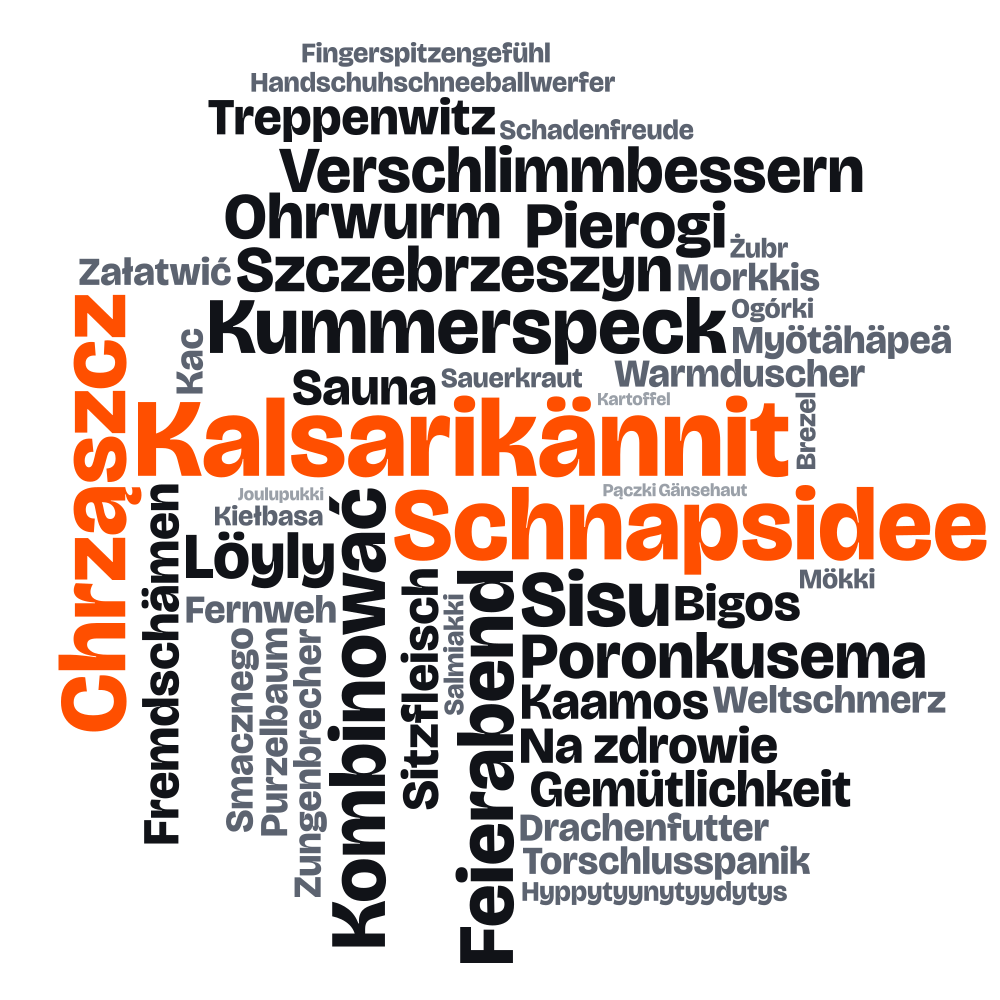
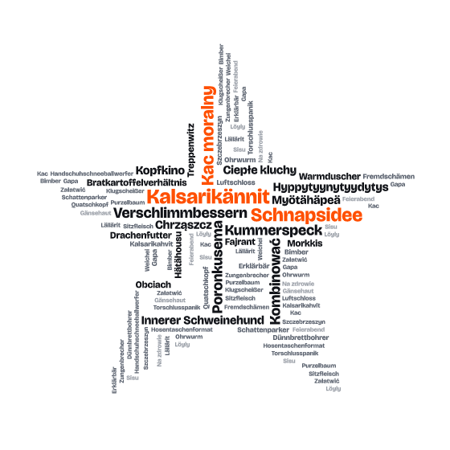

# wordcloud

A word list in, a word cloud out.

Every word is packed by its real letter shapes, not by boxes, so the cloud gets dense and stays
readable. One layout gives a light and a dark picture on a transparent background, as SVG and
PNG. The words fill the canvas, a circle or any picture you hand it. One small binary, or a
GitHub Action that keeps the cloud on your profile fresh.

<picture>
  <source media="(prefers-color-scheme: dark)" srcset="examples/cloud-dark.svg">
  
</picture>

<sub>Funny words from German, Polish and Finnish. _Kalsarikännit_: Finnish for drinking at home,
in your underwear, with no plans to go out.</sub>

## Install

```sh
cargo install --git https://github.com/mborejdo/wordcloud --locked
```

## Usage

```sh
wordcloud cloud.toml                       # cloud.svg and cloud-dark.svg
wordcloud cloud.toml --png                 # the PNGs too
wordcloud cloud.toml --shape circle        # a built-in shape: rect, ellipse, circle
wordcloud cloud.toml --shape star.png      # any picture as the shape
wordcloud cloud.toml --fill                # small copies of the lighter words fill the gaps
wordcloud cloud.toml --seed 7              # another seed, another layout
wordcloud cloud.toml --explain             # every final weight and why
wordcloud --help                           # all flags
```

The same list and seed always give the same picture.

## Word list

A bit of TOML. A bigger weight gives a bigger word:

```toml
[style]
width = 1000
height = 1000
shape = "circle"

[[tier]]
weight = 10
color = "accent"
words = ["Kalsarikännit"]

[[tier]]
weight = 7
color = "ink"
words = ["Sisu", "Feierabend", "Kombinować"]
```

`[style]` takes what the flags take: `width`, `height`, `seed`, `font`, `shape`, `invert`,
`vertical`, `fill`. A flag wins over the list. The full example, with colours for light and
dark, is [`examples/cloud.toml`](examples/cloud.toml).

## Shapes



```sh
wordcloud cloud.toml --shape examples/star.png --width 560 --height 560 --fill
```

- The picture is black on white: words go where it is dark. `--invert` swaps that.
- It is stretched to the canvas, so give the canvas the picture's proportions.
- `--fill` copies the lighter words into the gaps, small, up to four times each. That fills
  the shape into its corners.
- In the list: `shape = "star.png"`, relative to the list.

## Weights

- `terms` fold into the word they belong to (`k8s`, `kubectl` count for Kubernetes): exact
  match, your `related` lists, a built-in alias table, light stemming.
- `--corpus file.txt`: words your own text mentions more often grow. The text stays local.
- `--github user`: words that match a user's recent public languages and topics grow.
- `[semantic] backend = "embed"`: match terms with any OpenAI-compatible embeddings endpoint.
  It sends the word list only.

## On your GitHub profile

```yaml
- uses: mborejdo/wordcloud@v2
  with:
    wordlist: cloud.toml
    out: cloud.svg
    seed: ${{ github.run_number }}   # new layout every run
```

Copy [`examples/profile-workflow.yml`](examples/profile-workflow.yml) into your profile repo
(a daily reshuffle, plus a rebuild whenever you edit the list) and add
[`examples/README-snippet.md`](examples/README-snippet.md) to its README. For a wide banner:
`width = 1600`, `height = 600`, `fill = true`.

## Library

```toml
wordcloud = { git = "https://github.com/mborejdo/wordcloud", tag = "v2.0.1", default-features = false }
```

```rust
let source = wordcloud::Source::load("cloud.toml".as_ref())?;
let (words, _) = wordcloud::weigh(&source, "", &wordcloud::semantic::Offline, &[]);
let options = wordcloud::Options::from_style(&source.style);
// A built-in name or a picture file; `MaskImage::from_bytes` takes a picture from memory.
let shape = wordcloud::MaskImage::open("star.png", ".".as_ref(), &options, false)?;
let cloud = wordcloud::generate(&words, wordcloud::DEFAULT_FONT, &options, Some(&shape))?;
std::fs::write("cloud.svg", cloud.svg(None, false))?;
```

`default-features = false` leaves out the command line and the HTTP parts. `cargo doc --open`
has the rest.

## How it works

1. Each word is shaped with its real glyph outlines, kerning and ligatures included.
2. The outline becomes a small bitmap, widened by half the gap between words.
3. Largest first, each word spirals out from the centre and takes the first spot where its
   bitmap touches nothing. A shape marks its outside as taken.
4. The largest size at which every word fits is found by bisection.
5. The picture is written as glyph paths, so the SVG needs no font.

## Development

```sh
cargo fmt --all --check
cargo clippy --all-targets --all-features -- -D warnings
cargo clippy --all-targets --no-default-features -- -D warnings
cargo test --all-features
cargo test --no-default-features
RUSTDOCFLAGS="-D warnings" cargo doc --no-deps --all-features
cargo deny check
```

That is what CI runs. A change that moves words for the same list and seed is a breaking
change and goes in the [CHANGELOG](CHANGELOG.md).

Releases: bump `version` in `Cargo.toml` and push the tag `vX.Y.Z`. CI checks that they match,
builds the binaries and moves `vX`.

## License

Code: MIT or Apache-2.0. Bundled font: Bricolage Grotesque, SIL Open Font License 1.1.
